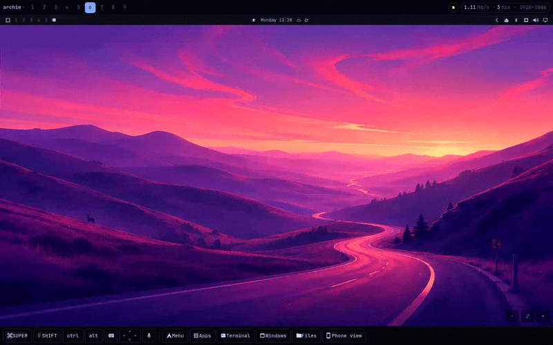
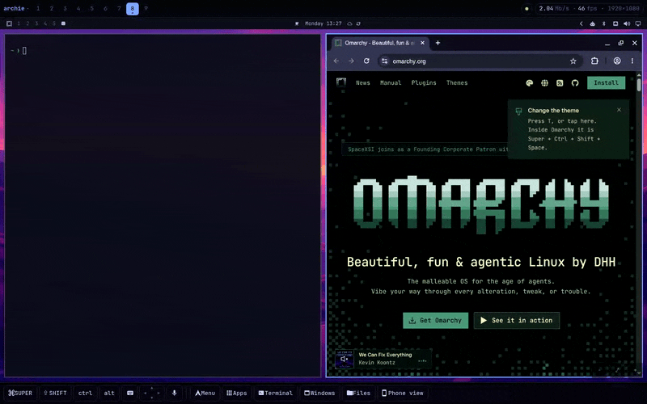
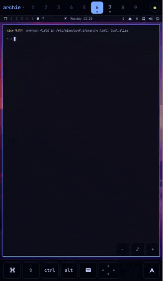
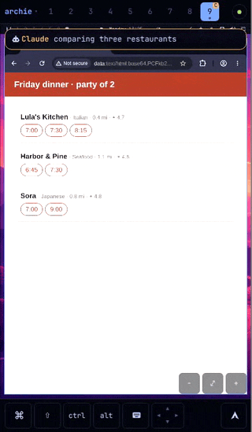
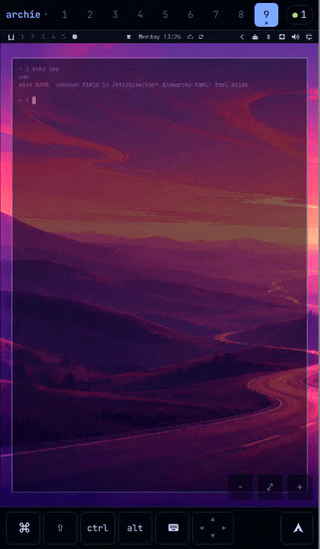
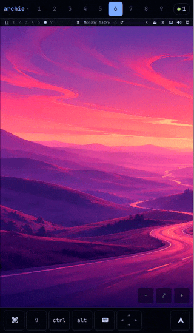

# omaspace in motion

Each of these is recorded from omaspace's live view, in a phone-sized or a
laptop-sized browser, on real Omarchy machines.

## Give a workspace

Another machine gives its workspace to this one: the terminal reopens in the
same folder and the browser with its tabs, on the same workspace. `omaspace
send <machine>`, the Spaces panel (`SUPER+CTRL+SHIFT+O`), or `SUPER+CTRL+ALT+O`
for the workspace you're on.

## Your desktop in a browser

The whole screen, with sharp text, in any browser on your tailnet. Type and
click as if you were there.

## On your phone

A phone gets a screen of its own, sized to the phone; the machine's monitor
carries on showing what it was. Tap a workspace to switch, tap a window and
type.

## When an agent needs you

An agent asks a question; your phone shows it. **Take over** pauses every
agent on that machine while you do it, **Hand back** lets them carry on.

## Move windows around

Long-press a window to lift it, drag it onto another to swap them. Let go
without dragging for its actions: close, float, or move it to another
workspace.

## Files

Browse the machine's files from your phone, open or download them, and
upload from the phone.

